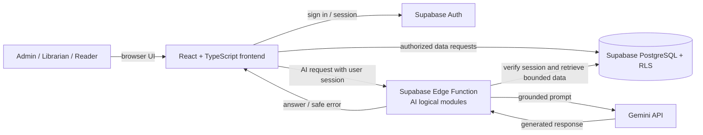

# Architecture — Library Management System

## Architecture Overview

This document describes the target architecture for the approved library-management requirements. It uses the existing React + TypeScript application and Supabase platform, with no additional independently deployed services. The browser handles presentation and user interaction; Supabase provides authentication, PostgreSQL storage, row-level security (RLS), database functions where coordinated business operations need them, and an Edge Function for server-side AI integration.

The architecture supports Admin, Librarian, and Reader workflows for the catalog, reader accounts, loans, reservations, fines, settings, statistics, and CSV reports. All three roles can use AI book search, summaries, and recommendations. AI responses are grounded in bounded data retrieved from the library database.

## Architectural Style

The system uses a small client-server architecture with a modular frontend and a Supabase backend. The frontend is organized by pages, shared components, context, and libraries, consistent with the existing project. It communicates with Supabase Auth and PostgreSQL through the Supabase client, subject to RLS. Coordinated business operations may use PostgreSQL RPC functions to keep related database changes atomic. AI requests go through a Supabase Edge Function.

The AI pipeline stages are logical modules within that Edge Function, not separate services: Question Analyzer, Structured Intent handling, Book Retriever, Context Builder, Prompt Builder, and Gemini Service. This keeps deployment and operations appropriate for a student project while preserving the required separation of responsibilities.

## System Context



External systems are Supabase Auth, Supabase-hosted PostgreSQL/RLS/RPC, the Supabase Edge Function runtime, and the Gemini API. The browser is an untrusted client. The Edge Function is a server-side boundary but must authenticate each request and enforce authorization; privileged database access must not bypass the intended user permissions without an explicit, narrowly scoped authorization check.

## Major Components

| Component | Responsibilities | Dependencies / communication |
|---|---|---|
| React + TypeScript frontend | Render role-appropriate pages; collect and validate user input; show loading, result, and friendly error states; present catalog and personal records; generate CSV from authorized, filtered data. | Supabase client; invokes AI Edge Function with the authenticated session. |
| Frontend pages and shared UI | Present login, dashboard, books, readers, loans, reservations, statistics, reports, settings, and AI screens. | Auth context, shared components, application libraries. |
| Auth context and route/page guards | Reflect the Supabase session and profile in the UI; provide navigation-level role awareness. Guards are usability controls, not the security enforcement boundary. | Supabase Auth and profile data through the Supabase client. |
| Supabase Auth | Authenticate users and issue/refresh sessions. Public registration creates Reader accounts only, according to the approved requirements. | Frontend; verified session claims consumed by backend services. |
| Supabase PostgreSQL | Store application records and provide relational queries and transactions. | Supabase client under RLS; Edge Function through an appropriately scoped database client; RPC where needed. |
| PostgreSQL RLS policies | Enforce row-level visibility and permitted operations for authenticated roles, including Reader access limited to their own records. | Authenticated database requests and session identity. |
| PostgreSQL RPC functions (where appropriate) | Encapsulate multi-record or concurrency-sensitive business operations where a transaction is needed to preserve an invariant. | Invoked through Supabase; authorization must be enforced by function checks and/or RLS. |
| Supabase Edge Function: AI endpoint | Authenticate the caller, validate the request, dispatch the requested AI use case, run logical RAG modules, call Gemini, and return a safe response. | Supabase Auth/session verification, PostgreSQL retrieval, server-side Gemini secret, Gemini API. |
| AI logical modules inside the Edge Function | Analyze question; represent structured intent; retrieve/rank books; build bounded context; build prompts; call Gemini and interpret its result. | Edge Function runtime; database client; Gemini Service. |
| Gemini API | Generate a response from the bounded prompt and retrieved library context. It is not an authority for catalog existence or user identity. | Called only by the Edge Function using a server-side secret. |

## Component Responsibilities

The browser may hide controls that are unavailable to a role, but authorization decisions must be enforced by RLS and backend checks. Supabase Auth establishes the user identity. Backend code verifies the session and derives the user ID and role from trusted session/database state; it does not accept client-supplied role or reader ID as authority.

The database is the source of truth for catalog and circulation data. The frontend may perform ordinary CRUD through the Supabase client where RLS is sufficient. Operations that must update related data together, such as creating a loan while decreasing availability, or completing a return while increasing availability and recording a fine, should use a database transaction, commonly exposed through an RPC function. The implementation must preserve the approved business rules and must not permit available inventory to become negative.

The Edge Function is responsible for server-side AI orchestration and the Gemini credential boundary. Its internal modules are separated by responsibility but remain in one deployable function. It validates inputs, verifies the caller, fetches only permitted and relevant data, constructs a bounded prompt, and returns user-safe errors.

## Frontend Architecture

The frontend remains a React + TypeScript single-page application. Pages correspond to the existing functional areas. Shared components provide layout and common UI; context holds cross-page authentication/session state; libraries encapsulate Supabase and AI request access; types describe data exchanged between components. This reflects NFR-006 without adding a new frontend framework or service layer.

Authenticated pages and actions are presented according to the current role. Responsive layout supports desktop and basic small-screen use, and the application targets modern Chrome and Edge. AI pages show a loading state while the Edge Function is processing. Frontend form validation improves feedback but does not replace backend/database validation.

## Authentication and Authorization Architecture

1. Supabase Auth handles sign-up, sign-in, session persistence, refresh, and sign-out. The application database does not store user passwords.
2. Public sign-up accepts the approved Reader fields and creates only a Reader with active card status. Admin/Librarian provisioning is not exposed through public registration.
3. The frontend reads the authenticated session and profile to choose appropriate navigation and pages. This is not a security control by itself.
4. RLS is enabled for business tables. Policies use the authenticated identity and approved role model; a Reader can access only their own personal, loan, reservation, and fine data, while public catalog visibility follows the approved catalog behavior.
5. Staff-only operations and Admin-only settings changes are enforced on the trusted database/backend boundary, not solely through disabled buttons or hidden pages.
6. Edge Function requests carry the caller's Supabase access token. The function verifies it with Supabase Auth before handling the request, derives the actor and role from verified identity and trusted profile data, and rejects unauthorized actions. It ignores or rejects client-supplied identity/role values where identity can be derived from the session.
7. The Gemini API key is stored as an Edge Function secret/environment variable. It is never sent to the browser or written to logs.

## Database/Data Access Architecture

Supabase PostgreSQL is the authoritative store. The browser's Supabase client uses the public/anonymous project key, which is not a secret, together with the user's session; RLS constrains data access. Secrets and privileged credentials remain server-side. The Edge Function should use the caller's verified context for user-scoped reads. If a privileged database credential is needed for a narrowly scoped operation, the function must perform explicit session-derived authorization and restrict the query to the permitted operation and data; it must never use a client-supplied reader ID as authorization.

Ordinary list/detail and CRUD operations can use Supabase data access protected by RLS and input validation. PostgreSQL constraints and transactions/RPC are appropriate for uniqueness, valid quantity bounds, and multi-record circulation updates. Statistics queries must support complete rankings as required rather than imposing an arbitrary 50/100-row cap. CSV export reads only the role-authorized dataset and current filters, and emits the approved columns and formatting.

This architecture does not prescribe a new schema or migration. Existing schema/migration details are outside this document's change scope.

## Library Business Flow

1. A user signs in through Supabase Auth. The frontend loads the profile associated with the verified session.
2. The user selects an allowed library operation. UI guards shape navigation; RLS and trusted operation checks decide access.
3. Catalog search and view requests query PostgreSQL under RLS. Admin/Librarian catalog changes are validated and persisted through authorized operations.
4. For loan creation, the trusted operation checks that the actor is Admin/Librarian, the Reader is active, and a copy is available; it records current borrow date and configured due date and decreases availability atomically.
5. For return, the trusted operation records current return date, marks the loan returned, increases availability atomically, and creates an unpaid fine when the approved overdue calculation applies.
6. Renewal and reservation operations check their approved eligibility and state-transition rules before changing records. Reservation order is based on reserved date; there is no automatic hold expiry.
7. Staff statistics and reports use authorized data. CSV applies current filters and the role's permitted export scope. Reader personal views remain scoped to the session identity.

## AI/RAG Architecture

AI use is available to Admin, Librarian, and Reader. All AI actions enter through the Supabase Edge Function, which verifies the Supabase user session and derives actor identity/role from the verified context. AI logical modules are functions/modules within that Edge Function; no independent AI microservices, vector database, or separate retrieval infrastructure is required by the approved requirements.

The AI request path is:

```text
Authenticated frontend
  → Supabase Edge Function (verify session, authorize, validate)
  → Question Analyzer
  → Structured Intent
  → Book Retriever
  → Context Builder
  → Prompt Builder
  → Gemini Service (server-side Gemini API call)
  → validated/grounded Answer returned to frontend
```

For search, the retriever queries PostgreSQL and applies the approved relevance ordering: title, author, category, description keywords, with borrowing popularity as tie-breaker. The context builder passes only selected matching book records, never the full database. The answer is constrained to those records; no matches and out-of-scope requests receive clear, appropriate responses. For recommendations, database-side selection enforces a maximum of five existing books and uses only the current Reader's own borrowing history when available; staff requests do not access another Reader's history. Gemini generates explanatory text, not catalog facts or authorization decisions.

## AI Search Flow

1. The frontend submits the natural-language Vietnamese question and the authenticated session to the Edge Function.
2. The function verifies the session, validates the question, and invokes the Question Analyzer.
3. The analyzer identifies whether the request is within book-search scope and produces Structured Intent for supported search criteria. Out-of-scope requests are declined without a Gemini catalog answer.
4. The Book Retriever queries current catalog data and ranks by title, author, category, then description-keyword match; equal relevance uses total borrow count descending.
5. If no matching books are found, return a clear no-results response. Do not broaden to arbitrary catalog rows as a fallback.
6. The Context Builder includes only retrieved book records and relevant fields. The Prompt Builder instructs Gemini to use only this context and not invent books/authors.
7. Gemini Service calls Gemini using a server-side secret. The function returns the answer and, where supported by the UI contract, the retrieved book references. The frontend displays a loading state until completion.

## AI Summary Flow

1. The frontend submits the selected book identifier and session.
2. The Edge Function verifies the session and validates the identifier.
3. The Book Retriever loads that one existing book. The Context Builder supplies only its title, author, category, description, and relevant metadata.
4. The Prompt Builder requests a Vietnamese summary of about 3–5 sentences grounded in that context.
5. If the selected book is absent or its available information is insufficient, return the appropriate not-found or insufficient-data response. Gemini must not add unsupported book content.
6. Gemini Service returns the summary through the Edge Function; the frontend shows loading and then the result or a friendly error.

## AI Recommendation Flow

1. The frontend requests recommendations with its authenticated session; any client-supplied reader ID is not used to select history.
2. The Edge Function verifies the session and derives the current actor. For a Reader, it may retrieve only that Reader's own borrowing history. For Admin/Librarian, it must not use another Reader's private history; no such history is required for staff recommendations.
3. The Book Retriever selects existing catalog books. With a Reader history, it favors previously borrowed categories/authors; without history, it ranks popular books by total borrow count descending.
4. The Context Builder supplies bounded candidate records and only the permitted preference/history signals. The Prompt Builder requests no more than five recommendations.
5. The result is limited to database-backed books, with a clear no-match response when applicable. Gemini may explain the recommendation but cannot create catalog entries.

## Security Boundaries

| Boundary | Trusted data / enforcement | Untrusted input or exposure |
|---|---|---|
| Browser boundary | None of the browser's role claims or submitted identifiers are authoritative. | User input, query/body fields, hidden-page state, and all JavaScript are client-controlled. |
| Supabase Auth boundary | Verified access token establishes authenticated subject. | A token supplied by the client must be cryptographically/session-verified; do not trust decoded, unverified claims. |
| PostgreSQL/RLS boundary | RLS and database checks enforce row and operation access using authenticated identity/role. Transactions preserve business invariants. | Frontend filtering and UI guards cannot substitute for policies or trusted checks. |
| Edge Function boundary | Server-side request validation, session verification, role authorization, bounded data retrieval, and safe response mapping. | Request body identity/role and arbitrary question text remain untrusted. Avoid exposing privileged service credentials. |
| Gemini boundary | Server-side API credential; send only the minimum context needed for the requested feature. | Gemini output is untrusted generated text; do not treat it as identity, authorization, or a source of catalog truth. |
| Secret/log boundary | Gemini key and other secrets live in Supabase secrets/environment variables. Logs omit secrets and sensitive prompts/identifiers where unnecessary. | Browser bundles, responses, and logs are not secret stores. |

Input is validated at frontend for usability and again at the Edge Function/database boundary. Client errors are mapped to understandable messages without stack traces or secret/provider details.

## External Dependencies

- **Supabase Auth:** registration, authentication, and sessions.
- **Supabase PostgreSQL:** application data, constraints, queries, transactions, and RLS.
- **Supabase Edge Functions:** server-side AI request handling and secret storage.
- **Gemini API:** language generation for grounded search, summaries, and recommendations.
- **Modern browsers:** Chrome and Edge support; desktop and basic responsive layouts.

The project does not require a separate application server, message queue, vector database, orchestration platform, or production availability/backup SLA under the approved requirements.

## Data Flow

For ordinary library operations, the browser sends validated requests through the Supabase client with its session. PostgreSQL evaluates RLS and constraints; data returns only within the caller's permissions. Coordinated writes execute transactionally, directly or through RPC.

For AI operations, the browser sends an action and task input with the access token to the Edge Function. The function verifies the token and role, derives identity from that verified session, retrieves the minimum permitted catalog/history context from PostgreSQL, constructs a prompt, and calls Gemini. Gemini's generated text returns to the function, which applies response/error handling before returning to the browser. The Gemini key never traverses the browser boundary.

For CSV, authorized report data is queried with the current filters and role scope, then serialized as UTF-8 with header, DD/MM/YYYY dates, and VNĐ amounts as specified. Readers have no CSV export feature.

## Error Handling Strategy

- Validate input at the boundary and return field/action-level messages for invalid requests.
- Distinguish authentication failure, authorization denial, validation failure, missing records, business-rule conflict, database failure, and Gemini/provider failure internally.
- Return stable, user-friendly messages and appropriate status codes; do not return stack traces, secret values, raw provider errors, or detailed database internals.
- Log operational failures with enough context for debugging while excluding API keys and avoiding unnecessary personal data or full prompts.
- Handle AI no-match, out-of-scope, and insufficient-summary-data cases as expected outcomes, not fabricated answers.
- Keep the UI loading state active while AI requests are pending and clear it on success or failure.

## Non-functional Requirement Support

| Requirement | Architecture support |
|---|---|
| NFR-001: ordinary CRUD in a few seconds in the project environment | Direct Supabase queries for ordinary operations; avoid unnecessary service hops; use suitable database queries. This is a target, not a production SLA. |
| NFR-002: AI loading state | AI screens present pending state for Edge Function/Gemini requests. |
| NFR-003: desktop and basic small-screen responsiveness | React presentation layer uses responsive layouts. |
| NFR-004: availability never negative | Transactional loan/return operations and database-side validation prevent invalid inventory updates. |
| NFR-005: useful errors without stack traces | Backend error mapping and frontend friendly error presentation. |
| NFR-006: clear component/page/lib/context separation | Preserve and extend the existing React project organization. |
| NFR-007: separated AI processing responsibilities | Keep named analyzer, intent, retriever, context, prompt, and Gemini modules inside the Edge Function. |
| NFR-008: modern Chrome and Edge | Standard React/browser APIs and supported modern-browser target. |
| NFR-009: no production backup/availability SLA | Do not introduce unsupported availability commitments or infrastructure. |
| NFR-010: AI key server-side and absent from logs | Store as Supabase secret/environment variable; invoke Gemini only from the Edge Function; redact secrets from logs. |

## Requirement-to-Architecture Traceability

| Requirement IDs | Architectural support |
|---|---|
| FR-001; BR-001; US-001–US-002; AC-001.x–AC-002.x | Supabase Auth, Reader-only public registration, profile/session context, no application password storage. |
| FR-002, FR-004; US-003–US-005; AC-003.x–AC-005.x | Role-aware frontend plus trusted authorization, RLS, scoped Reader access, protected account-management actions. |
| FR-003; BR-002; US-006–US-007; AC-006.x–AC-007.x | Catalog pages, PostgreSQL queries/constraints, staff write authorization, reader search, deletion conflict checks. |
| FR-005–FR-008; BR-003–BR-005; US-008–US-011; AC-008.x–AC-011.x | Transactional/RPC-capable circulation operations, settings reads, availability invariant, overdue and renewal checks. |
| FR-009; BR-006; US-012–US-013; AC-012.x–AC-013.x | Reservation operations with role/ownership checks, pending uniqueness, ordering, state transitions, no automatic expiry. |
| FR-010; BR-007; US-010, US-014; AC-010.x, AC-014.x | Return transaction and fine creation, payment-state operation, RLS-scoped Reader fine view. |
| FR-011; BR-008; US-015; AC-015.x | Statistics queries over complete ranked data, including overdue and popularity definitions. |
| FR-012; US-016, US-023; AC-016.x, AC-023.x | Role-scoped report queries, current-filter application, approved CSV fields and encoding/formatting. |
| FR-013; US-017; AC-017.x | Admin-only settings access and validation at trusted boundary. |
| FR-014; BR-009; US-018; AC-018.x | Edge Function RAG search modules; database-backed retrieval, ranking, bounded context, Gemini grounding, no-match and out-of-scope handling. |
| FR-015; US-019; AC-019.x | Edge Function summary path using only selected book data and insufficient-data handling. |
| FR-016; BR-009; US-020; AC-020.x | Edge Function recommendation path; session-derived Reader history, popular fallback, maximum five database-backed results. |
| FR-017; US-022; AC-022.x | Authenticated sessions, RLS, backend identity derivation, validation, secret isolation, safe errors/logging. |
| NFR-001–NFR-010; US-021–US-022; AC-021.x–AC-022.x | Query and UI structure, loading/error behavior, responsive/browser support, transactional invariants, modular code, no unsupported SLA, secret controls. |

## Architectural Risks / Open Questions

- **Existing AI implementation alignment:** the inspected Edge Function currently calls an OpenAI-compatible endpoint and reads `OPENAI_API_KEY`; the approved architecture requires Gemini. It also creates a service-role database client without visibly verifying the caller's Supabase session before processing. Before the AI implementation is considered aligned, it must use Gemini, verify each session, derive identity/role server-side, and apply the required privacy and authorization rules. This architecture document does not change code.
- **AI retrieval behavior:** the current function's broad catalog fetch/fallback and fixed row limits do not by themselves guarantee the approved relevance ordering, complete retrieval behavior, bounded matching context, or popular-book ordering. Retrieval must be designed to satisfy the approved ordering without sending the whole catalog to Gemini. Exact ranking implementation and query strategy remain implementation choices.
- **RPC versus direct writes:** requirements define invariants but do not mandate which individual operations use RPC. Select transactional database functions for operations whose multi-record consistency cannot be assured by independent client writes.
- **Role source and provisioning:** the approved requirements specify role behaviors but do not define an administrative provisioning workflow or the exact trusted storage mechanism for staff roles. Public registration must never assign staff roles; staff provisioning remains an operational decision outside the approved workflow.
- **Gemini operational configuration:** model/version, quotas, timeout/retry policy, and deployment secret setup are not specified. Choose values during implementation without changing user-visible business rules; do not log credentials.
- **Current table policies/behavior:** this design relies on effective RLS and transactional enforcement. Existing migration review is not a schema change authorization; any implementation gap should be handled separately from this documentation phase.

No new business rules are introduced here. Where the approved requirements do not specify an implementation detail, it is identified as an implementation choice or open question.
